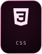
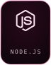
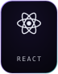

 

**[PROJECTS](https://github.com/devalpona?tab=repositories)** &nbsp;·&nbsp; **[FOLLOW](https://github.com/devalpona)** &nbsp;·&nbsp; **[CONTACT](#contact)**

 

<!-- [EDIT] Replace every YOUR-* placeholder below with your real profile URL / email. -->

  

<!--
  Everything below is deliberately factual. Nothing here claims experience, employers,
  awards or clients. Replace the [EDIT] markers with your own verified details.
-->

 

## `01` / PHILOSOPHY

> Code is a material. Systems have shape. Motion is how you read it.

From **Chittagong Independent University (CIU)**. I build things at the point where software engineering meets generative design.
This profile's artwork is itself a small system: every graphic is produced by one deterministic script, so the visuals are versioned, reproducible and editable like any other code.

<!-- [EDIT] Add one or two sentences about what you are working on or learning right now. -->

## `02` / SELECTED WORK

<!-- [EDIT] Add only repositories you have verified. Suggested format per project:

**[repo-name](https://github.com/devalpona/repo-name)**
One factual sentence describing what it does.
-->

*Selected projects will be listed here once curated. Until then, everything public lives in* **[the repository index](https://github.com/devalpona?tab=repositories)**.

## `03` / TECHNICAL UNIVERSE

<!-- [EDIT] Keep only languages/tools you actually use. To add or remove tiles: edit LANGUAGES in scripts/generate-art.mjs, run npm run generate:art, then update this list. -->

## `04` / SIGNAL

<!-- Third-party image: may be rate-limited or unavailable. The alt text and the link below carry the same information. -->

## `05` / CONTACT

<!-- [EDIT] Add links you want public, e.g. portfolio, LinkedIn, email. -->

Open an issue or discussion on any repository, or follow along at **[github.com/devalpona](https://github.com/devalpona)**.

 

**[EXPLORE THE PROJECTS →](https://github.com/devalpona?tab=repositories)**

